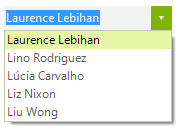
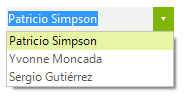

# Filtering

`RadDropDownList` in Progress® Telerik® UI for WinForms supports filtering. To apply a filter, set the `Filter` property to a predicate. The control evaluates the predicate for each data item to determine whether to display it.

## Filter

<snippet id='dropdownlist-filtering-filter-cs' />
<snippet id='dropdownlist-filtering-filter-vb' />

 

## Filtering Predicate

<snippet id='dropdownlist-filtering-filteringpredicate-cs' />
<snippet id='dropdownlist-filtering-filteringpredicate-vb' />

 
 

When you apply this filter to a `RadDropDownList` bound to the `Northwind.Customers` table, the control displays the following result:
        
>caption Figure 1: Filter

You can also filter items by setting the `FilterExpression` property.

## Filtering Expression

<snippet id='dropdownlist-filtering-filteringexpression-cs' />
<snippet id='dropdownlist-filtering-filteringexpression-vb' />

 
 
>caption Figure 2: FilteringExpression

>note The `IsFilterActive` property indicates whether the `Filter` or `FilterExpression` property has a value.

## See Also

* [Configure auto-completion in RadDropDownList]()
* [Sort RadDropDownList items]()
* [Configure selection in RadDropDownList]()
