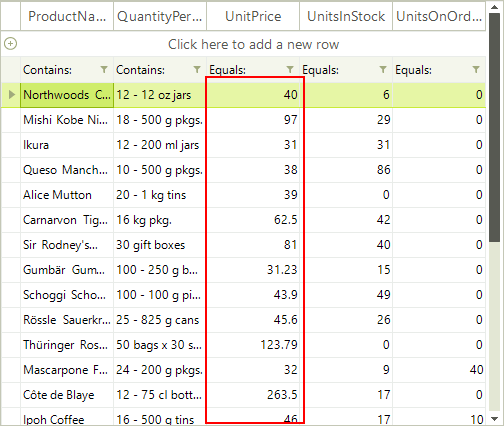
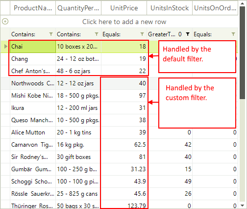

# Custom Filtering

Progress® Telerik® UI for WinForms custom filtering lets you apply custom logic to `RadGridView` rows. It takes precedence over filter descriptors added in code or through the filtering row.

Custom filtering runs only when filtering is enabled through the `EnableFiltering` or `GridViewTemplate.EnableFiltering` properties. By default, filtering is disabled at all levels.

`RadGridView` provides two mechanisms for custom filtering:

* Handling the `CustomFiltering` event.

* Replacing the `RadGridView` filtering mechanism by providing a custom `FilterPredicate`.

## Using the CustomFiltering Event

The `CustomFiltering` event fires when custom filtering is enabled. It lets you control whether a row appears in the filtering results.

The `CustomFiltering` event arguments provide the following properties:

* `Template`&mdash;The template that holds the rows where filtering is applied

* `Row`&mdash;The row to be filtered

* `Visible`&mdash;Defines whether the row appears in the filtering results

* `Handled`&mdash;Defines whether the custom algorithm or the applied filter descriptors process the row

The following example shows how to hide rows with a `UnitPrice` value below 30. The added `FilterDescriptor` for `UnitPrice` does not affect which rows the custom logic hides.

<snippet id='gridview-customfiltering-usingcustomfiltering-cs' />
<snippet id='gridview-customfiltering-usingcustomfiltering-vb' />
<snippet id='gridview-customfiltering-usingcustomfiltering1-cs' />
<snippet id='gridview-customfiltering-usingcustomfiltering1-vb' />

>caption Rows with UnitPrice values below 30 are hidden by the custom filtering logic

The following example shows how to use the `Handled` property of the `CustomFiltering` event arguments. It hides rows where `UnitPrice` is less than 30 and `ProductName` does not start with "Ch". A `FilterDescriptor` also hides rows where `UnitsInStock` is less than 1.

<snippet id='gridview-customfiltering1-usingcustomfilteringplushandled-cs' />
<snippet id='gridview-customfiltering1-usingcustomfilteringplushandled-vb' />
<snippet id='gridview-customfiltering1-usingcustomfilteringplushandled1-cs' />
<snippet id='gridview-customfiltering1-usingcustomfilteringplushandled1-vb' />

>caption Rows that pass the custom event logic and the UnitsInStock filter remain visible

>important To determine whether a row is visible when the grid is filtered by several columns, use the `MasterTemplate.DataView.FilterEvaluate` method in the `CustomFiltering` event. The method accepts a `FilterDescriptor` and a row, then returns whether the row is visible according to that descriptor. You can combine custom logic for one column with the default evaluation of filters on other columns.

## Implementing Filtering Mechanism Using FilterPredicate

Replace the `RadGridView` filtering mechanism with a custom one by setting `FilterPredicate` on `GridViewTemplate`.

The following example shows how to use custom filtering in `RadGridView` to hide rows where `UnitPrice` is less than 30:

<snippet id='gridview-customfiltering-usingfilterpredicate-cs' />
<snippet id='gridview-customfiltering-usingfilterpredicate-vb' />
<snippet id='gridview-customfiltering-usingfilterpredicate1-cs' />
<snippet id='gridview-customfiltering-usingfilterpredicate1-vb' />

## See Also
* [Basic Filtering]()

* [Customizing composite filter dialog]()

* [Events]()

* [Excel-like filtering]()

* [FilterExpressionChanged Event]()

* [Filtering Row]()

* [Put a filter cell into edit mode programmatically]()

* [Setting Filters Programmatically (composite descriptors)]()
