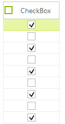
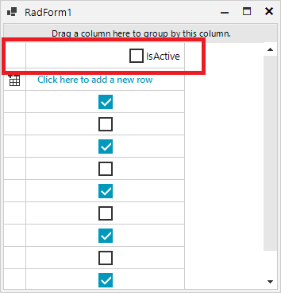
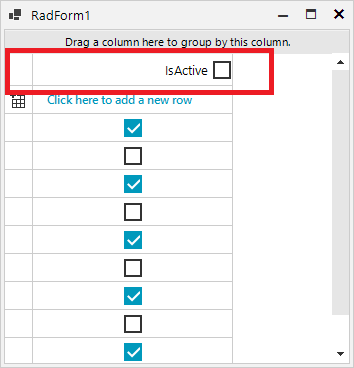

# GridViewCheckBoxColumn

In **Progress® Telerik® UI for WinForms**, `GridViewCheckBoxColumn` displays and lets users edit Boolean data in `RadGridView`. Checkboxes let users set or clear the underlying Boolean values. `GridViewCheckBoxColumn` inherits from `GridViewDataColumn`.

The following screenshot shows `GridViewCheckBoxColumn` displaying Boolean values as checkboxes.

## Adding a GridViewCheckBoxColumn

<snippet id='gridview-gridviewcheckboxcolumn1-addcheckboxcolumn-cs' />
<snippet id='gridview-gridviewcheckboxcolumn1-addcheckboxcolumn-vb' />

The column can display a checkbox in its header cell to check all checkboxes in the column. Set the `EnableHeaderCheckBox` property to `true` to show the embedded `RadCheckBoxElement`.

<snippet id='gridview-gridviewcheckboxcolumn1-enableheadercheckbox-cs' />
<snippet id='gridview-gridviewcheckboxcolumn1-enableheadercheckbox-vb' />

## ValueChanged Event

Use the `ValueChanged` event to handle a checkbox state change. Check the active editor type, as shown in the examples:

<snippet id='gridview-gridviewcheckboxcolumn1-valuechanged-cs' />
<snippet id='gridview-gridviewcheckboxcolumn1-valuechanged-vb' />

## HeaderCellToggleStateChanged Event

Use the `HeaderCellToggleStateChanged` event of `RadGridView` to handle changes to the header checkbox's toggle state.

<snippet id='gridview-gridviewcheckboxcolumn1-headercelltogglestatechanged-cs' />
<snippet id='gridview-gridviewcheckboxcolumn1-headercelltogglestatechanged-vb' />

## EditMode

The `EditMode` property controls when the editor submits its value to the cell. By default, the value is submitted when the current cell changes or the grid loses focus (`OnValidate`). Set `EditMode` to `OnValueChange` to submit the value immediately after it changes.

<snippet id='gridview-gridviewcheckboxcolumn1-editmode-cs' />
<snippet id='gridview-gridviewcheckboxcolumn1-editmode-vb' />

## GridViewCheckBoxColumn Properties

|Property|Description|
|----|----|
|`ThreeState`|Gets or sets whether to use a three-state checkbox.|
|`DataType`|Gets or sets the column's data type.|
|`EnableHeaderCheckBox`|Gets or sets whether to show a checkbox in the header cell.|
|`Checked`|Gets whether the checkbox in the header cell is checked.|
|`ShouldCheckDataRows`|Determines whether the header checkbox is synchronized with the data cells.|
|`EditMode`|Determines whether a checkbox value is submitted immediately (`OnValueChange`) or when the current cell changes or the grid is validated (`OnCellChangeOrValidating`).|
|`HeaderCheckBoxPosition`|Controls the position of the checkbox and text. Possible values are `Left`, `Right`, and `Center`.|
|`HeaderCheckBoxAlignmentProperty`|Controls the checkbox alignment relative to the text.|
|`CheckFilteredRows`|Gets or sets whether the header checkbox checks hidden rows.|

The following table compares the header checkbox position and alignment settings.

|`HeaderCheckBoxPosition`/`HeaderCheckBoxAlignment`|Result|
|----|----|
|`HeaderCheckBoxPosition` = `HorizontalAlignment.Right` & `HeaderCheckBoxAlignment` = `ContentAlignment.MiddleLeft`|The following image shows this setting: |
|`HeaderCheckBoxPosition` = `HorizontalAlignment.Right` & `HeaderCheckBoxAlignment` = `ContentAlignment.MiddleRight`|The following image shows this setting: |

## See Also

* [How to Convert a GridViewCheckBoxColumn to a Custom ToggleSwitch Column]()

* [GridViewBrowseColumn]()

* [GridViewCalculatorColumn]()

* [GridViewColorColumn]()

* [GridViewComboBoxColumn]()

* [GridViewCommandColumn]()

* [GridViewDateTimeColumn]()

* [GridViewDecimalColumn]()

* [GridViewHyperlinkColumn]()

* [GridViewSparklineColumn]()
