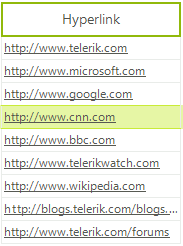

# GridViewHyperlinkColumn

__GridViewHyperlinkColumn__ allows __RadGridView__ to display, format, edit, and open hyperlinks. Default navigation requires both link-format validation and an absolute `http`, `https`, or `mailto` URI. Executables, file paths, and other schemes are not opened automatically. The default editor of the column is __RadTextBoxEditor__.

Here is how to create and populate __GridViewHyperlinkColumn__:

<snippet id='gridview-gridviewhyperlinkcolumn1-addhyperlinkcolumn-cs' />
<snippet id='gridview-gridviewhyperlinkcolumn1-addhyperlinkcolumn-vb' />



## Behavior customization

You can choose the mouse action that requests hyperlink navigation using the `HyperlinkOpenAction` property of the column. This setting does not bypass destination validation. It is an enumeration with the following members:

* __SingleClick:__ opens the hyperlink on single mouse click

* __DoubleClick:__ opens the hyperlink on double mouse click 

* __None:__ the user cannot open the link.

The __HyperlinkOpenArea__ property of the column determines whether to execute the hyperlink upon click on the cell or upon click on the text of the cell.
        

## Appearance

The __RadGridView__ theme could define styles for the following __GridViewHyperlinkColumn__ cells states:
        

* __Default (unvisited)__

* __Hovered__

* __Clicked__

* __Visited__

The mouse cursor transforms into ‘*hand*’ when hovering hyperlink from the column. 

## Cell Customization

The hyperlink cells can be further customized through the **CellFormating** event of the **RadGridView**. In the event handler, we can check if the **e.CellElement** property is a **GridHyperlinkCellElement** element. If yes, we can modify the look of the cell.

<snippet id='gridview-gridviewhyperlinkcolumn1-customizehyperlinkcolumncell-cs' />
<snippet id='gridview-gridviewhyperlinkcolumn1-customizehyperlinkcolumncell-vb' />

## Events

Here are the __GridViewHyperlinkColumn__ specific events:

* __HyperlinkOpening:__ cancelable event which is raised before opening the hyperlink

* __HyperlinkOpened:__ event which is raised after opening the link.

`HyperlinkOpeningEventArgs.IsTrustedUrl` is initialized from `HyperlinkHelper.ValidateLinkPattern` and `HyperlinkHelper.ValidateLinkScheme`. Set it to `true` only after checking `e.Hyperlink` against your application's approved destinations. Set `e.Cancel` to `true` to stop the request before the shared `HyperlinkHelper.HyperlinkClicked` event is raised. The shared handler can approve an untrusted request or suppress default navigation with `Handled`.

__Approving a Specific Application Link__

```C#
this.radGridView1.HyperlinkOpening += (sender, e) =>
{
	if (string.Equals(e.Hyperlink, "contoso-help://help/start",
		System.StringComparison.Ordinal))
	{
		e.IsTrustedUrl = true;
	}
};
```

This example permits only the exact application-controlled destination. Ensure that its registered protocol handler is trusted. Other requests keep their default trust state. A blocked or canceled request does not mark the cell visited and does not raise `HyperlinkOpened`. For both validation checks and the default scheme allowlist, see [shared hyperlink validation](#shared-hyperlink-validation). For a cross-control approval example, see [handling links across controls](#handling-links-across-controls).

>important Hyperlink cells no longer automatically launch executables, file/UNC paths, FTP URLs, OneNote links, or custom protocols. Applications that previously relied on this behavior must explicitly handle or approve the destination. `HyperlinkOpenAction` controls the click gesture, not permission to open the target.

The following example demonstrates how to replace the default **GridViewTextBoxColumn** with a **GridViewHyperlinkColumn** which stores emails. When an email hyperlink is clicked, a mail message is opened in the default Mail application:

<snippet id='gridview-gridviewhyperlinkcolumn1-emailcolumn-cs' />
<snippet id='gridview-gridviewhyperlinkcolumn1-emailcolumn-vb' />

## See Also

* [Shared Hyperlink Validation](#shared-hyperlink-validation)

* [GridViewBrowseColumn]()

* [GridViewCalculatorColumn]()

* [GridViewCheckBoxColumn]()

* [GridViewColorColumn]()

* [GridViewComboBoxColumn]()

* [GridViewCommandColumn]()

* [GridViewDateTimeColumn]()

* [GridViewDecimalColumn]()

* [GridViewSparklineColumn]()

