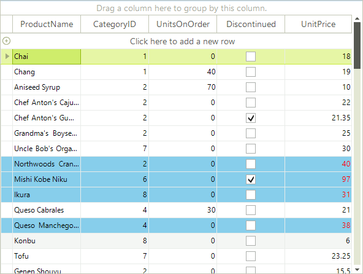
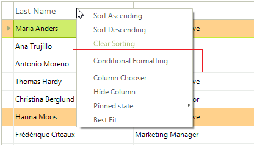
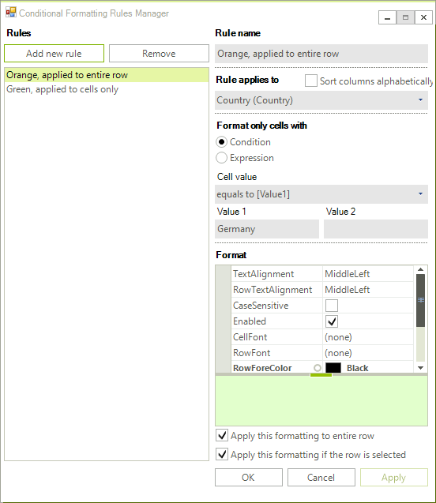

# Conditional Formatting Rows

In Progress® Telerik® UI for WinForms, you can use the `ConditionalFormattingObject` class to style cells and rows based on data conditions. Set a condition in its constructor. The constructor parameters are:

* The name of the condition.

* A `ConditionTypes` enumeration value: `Equal`, `NotEqual`, `StartsWith`, `EndsWith`, `Contains`, `DoesNotContain`, `Greater`, `GreaterOrEqual`, `Less`, `LessOrEqual`, `Between`, or `NotBetween`.

* A string for the first value used to test the condition.

* A string for the second value used to test the condition.

* An `ApplyToRow` Boolean that, when set to `true`, formats the entire row that contains the cell.

The `ConditionalFormattingObject` also contains the following formatting properties for the cell, row, and text alignment:

* `CellBackColor`: Sets the background color for the cell.
        

* `CellForeColor`: Sets the cell text font color.
        

* `CellFont`: Sets the cell text font.
        

* `RowBackColor`: Sets the background color for the entire row that contains the cell.
        

* `RowForeColor`: Sets the cell text font color for the entire row that contains the cell.
        

* `RowFont`: Sets the cell text font for the entire row that contains the cell.
        

* `TextAlignment` is a `ContentAlignment` enumeration value that can be `TopLeft`, `TopCenter`, `TopRight`, `MiddleLeft`, `MiddleCenter`, `MiddleRight`, `BottomLeft`, `BottomCenter`, or `BottomRight`.

## Conditional Formatting Rows

This example uses the same condition as the [cell formatting example](). Setting the `ApplyToRow` parameter to `true` lets the `RowBackColor` property format the entire row. The following image shows the matching rows highlighted.

<snippet id='gridview-conditionalformattingrows-conditionalformatting-cs' />
<snippet id='gridview-conditionalformattingrows-conditionalformatting-vb' />

>caution The declarative nature of Conditional Formatting limits the situations in which it can be used. While the provided functionality covers most scenarios, there are situations in which you will need to use [events]().
>

`RadGridView` includes a dialog that end users can use to create formatting objects. Open the dialog from a header cell's context menu. Handle the `ConditionalFormattingFormShown` event to access and customize the dialog.

The following image shows the conditional formatting option in the header cell's context menu.

The following image shows the Conditional Formatting Rules Manager.

## See Also
* [Adding and Inserting Rows]()

* [Creating Custom Rows]()

* [Drag and Drop]()

* [Formatting Rows]()

* [GridViewRowInfo]()

* [Iterating Rows]()

* [New Row]()

* [Painting Rows]()
