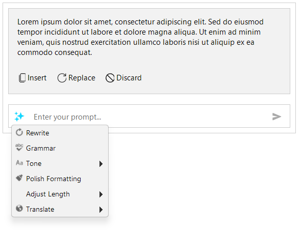

# WinForms Inline AI Assistant Overview

The Telerik UI for WinForms `RadInlineAIAssistant` component displays a prompt popup at the caret or selection of a text control. Users can enter a prompt or select an application-defined command, review the response, and insert it or use it to replace selected text without leaving the editor.

`RadInlineAIAssistant` is a nonvisual component, not a text editor. It does not call an AI service itself. Your application handles the `PromptRequest` event, sends the required context to its chosen service, and supplies the response.

## Key Features

* **Contextual prompts**: Open the popup at the caret or selection and access the selected text through the request event data.
* **[Predefined commands]()**: Populate the commands dropdown with actions such as rewriting, correcting grammar, translating, or changing tone. Commands can be organized into groups.
* **[Complete and streamed responses]()**: Supply a complete response or append chunks while the request is processing.
* **Response actions**: Insert the response at the caret, replace selected text, or discard the response and continue prompting. The interaction provider determines whether insertion and replacement are available.
* **Request cancellation**: Pass the request's cancellation token to your service. Request-specific response methods ignore updates from requests that are no longer active.
* **[Popup customization]()**: Configure the prompt placeholder, popup width, response height, and theme. Use the [events]() to control opening, closing, and response actions.

See [Getting Started]() for a working example and [Properties, Methods, and Events]() for the component API.

## Supported Hosts

An [interaction provider]() connects the assistant to a host. It supplies text and popup coordinates and applies the response to the host.

| Host | Setup |
| --- | --- |
| Windows Forms `TextBoxBase` controls, including `TextBox` and `RichTextBox` | Call `AttachTo(host)` to create a built-in provider. |
| `RadTextBox` and `RadTextBoxControl` | Call `AttachTo(host)` to create a built-in provider. |
| `RadRichTextEditor` | Assign the editor's `InlineAIAssistant` property to attach the assistant and configure the editor-specific provider. |

## AI Service Integration

The application chooses the AI service and decides which text to send. `PromptRequest` exposes the prompt, selected text, and lazily retrieved full host text. Accessing these values does not send them to a service automatically.

Use the event data's `SetResponse` method for a complete response, or `AppendResponse` followed by `CompleteResponse` for streaming. Handle service failures with `FailResponse`. The component manages the response display; it does not supply an AI model, credentials, or a built-in rewrite or translation service.

## See Also

* [Getting Started]()
* [Design Time]()
* [Properties, Methods, and Events]()
* [Visual Structure]()
* [Configuring Interaction Providers]()
* [Configuring Commands]()
* [Handling Responses]()
* [Customizing Appearance]()
* [Events]()
