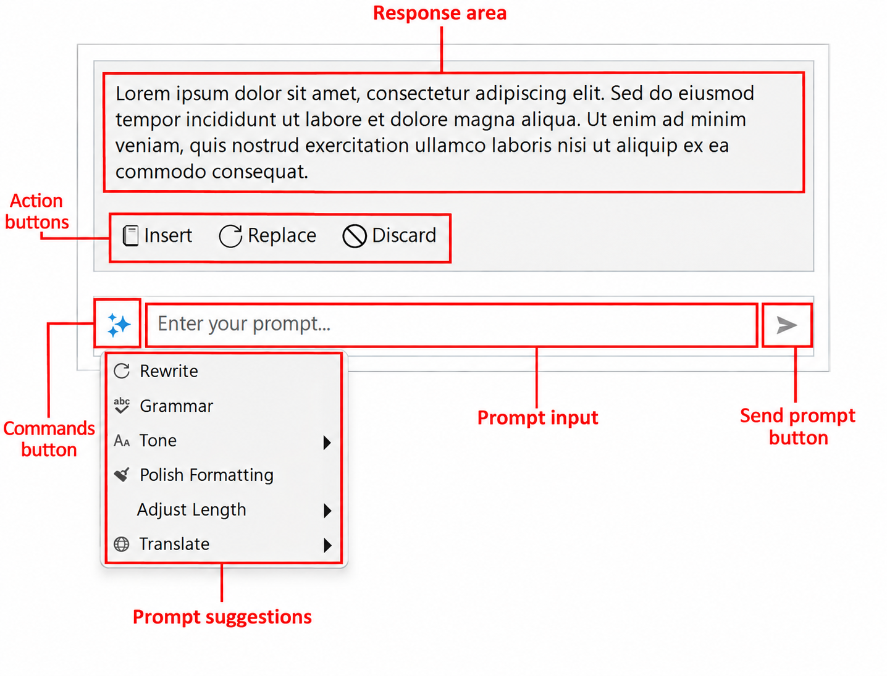

# Inline AI Assistant Visual Structure

Telerik UI for WinForms `RadInlineAIAssistant` is a nonvisual component that owns a popup. The popup contains the prompt input and an optional response area built with Telerik Presentation Framework (TPF) elements.

## Popup Layout

The response area appears above the prompt input when response text is supplied. The following diagram shows the main visual areas, not every internal layout element.

The component is not itself a text editor. Its interaction provider connects this popup to the host's text, selection, and caret position. See [Configuring Interaction Providers]().

## Accessing the Elements

Use the following public properties to access the main elements. Paths are relative to the `RadInlineAIAssistant` instance.

| Visual area | Access path | Type |
| --- | --- | --- |
| Popup window | `Popup` | `InlineAIAssistantPopup` |
| Prompt input | `InlineAIAssistantElement.PromptInputElement` | `RadPromptInputElement` |
| Commands button | `InlineAIAssistantElement.CommandsButton` | `LightVisualButtonElement` |
| Response area | `InlineAIAssistantElement.ResponseElement` | `InlineAIAssistantResponseElement` |
| Response text | `InlineAIAssistantElement.ResponseElement.ResponseTextElement` | `LightVisualElement` |
| Insert button | `InlineAIAssistantElement.ResponseElement.InsertButton` | `AIPromptButtonElement` |
| Replace button | `InlineAIAssistantElement.ResponseElement.ReplaceButton` | `AIPromptButtonElement` |
| Discard button | `InlineAIAssistantElement.ResponseElement.DiscardButton` | `AIPromptButtonElement` |

Use these properties instead of depending on child indexes. See [Customizing Appearance]() for examples.

## Prompt and Commands

`NullText` supplies the placeholder in the empty prompt. The command button opens a separate dropdown of `InlineAIAssistantCommand` and `InlineAIAssistantCommandGroup` entries. The prompt input's own suggestion lists are not used for this dropdown.

The component's `Commands` collection configures the dropdown. `InlineAIAssistantElement.IsCommandsMenuOpen` reports whether it is open, and `ShowCommandsMenu()` on that element opens it when commands are available. See [Configuring Commands]().

## Response Area and Actions

The response is displayed as read-only text in a scroll viewer. `ResponseMaxHeight` limits its height, while the popup grows or shrinks as content changes. The response area is initially hidden.

During a request, the prompt shows its processing state. Streamed chunks can appear before generation finishes. The component enables Insert and Replace after completion according to the host provider's capabilities. An error response does not enable these editing actions.

**Insert** and **Replace** apply text to the host and request a close. **Discard** clears the response and returns focus to the prompt without closing the assistant. See [Handling Responses]().

## See Also

* [Overview]()
* [Getting Started]()
* [Customizing Appearance]()