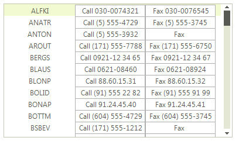
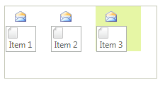
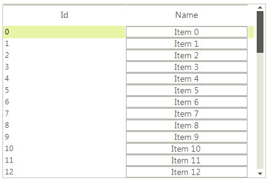

# Custom Items

Use the `RadListView` control in **Progress® Telerik® UI for WinForms** to create custom visual items in `ListView` and `IconsView`, and custom cells in `DetailsView`.

## Custom Items in ListView View Type

Use the `VisualItemCreating` event to create a visual item with two buttons, as shown in the following example.

>caption Figure 1: Custom `SimpleListViewVisualItem`

### Creating Custom Items

Create a custom visual item by inheriting from `SimpleListViewVisualItem`:

<snippet id='listview-listviewcustomitems-customitem-cs' />
<snippet id='listview-listviewcustomitems-customitem-vb' />

### Using Custom Items

Handle the `VisualItemCreating` event to use the custom items:

<snippet id='listview-listviewcustomitems-usecustomitem-cs' />
<snippet id='listview-listviewcustomitems-usecustomitem-vb' />

## Custom Items in IconsView View Type

>caption Figure 2: Custom `IconListViewVisualItem`

Create a custom visual item that inherits from `IconListViewVisualItem`. Add custom elements to the `Children` collection, as shown in the following examples.

### Creating Custom Items

<snippet id='listview-listviewcustomitems-customiconlistviewvisualitem-cs' />
<snippet id='listview-listviewcustomitems-customiconlistviewvisualitem-vb' />

### Using Custom Items

Subscribe to the `VisualItemCreating` event and replace the default item with the custom item:

<snippet id='listview-listviewcustomitems-usecustomiconitem-cs' />
<snippet id='listview-listviewcustomitems-usecustomiconitem-vb' />

## Custom Items in DetailsView View Type

In `DetailsView`, `RadListView` displays a cell for each data field. To create custom cells, subscribe to the `CellCreating` event and replace the default `DetailListViewDataCellElement` with a custom cell.

>caption Figure 3: Custom `DetailListViewDataCellElement`

Populate `RadListView` with items and set its `ViewType` property to `DetailsView`:

<snippet id='listview-listviewcustomitems-filldata-cs' />
<snippet id='listview-listviewcustomitems-filldata-vb' />

Create a custom cell element that contains a `RadButtonElement` and inherits from `DetailListViewDataCellElement`:

<snippet id='listview-listviewcustomitems-customcell-cs' />
<snippet id='listview-listviewcustomitems-customcell-vb' />

Due to the virtualization mechanism of the RadListView control, the default cell of the control is compatible with all columns. When the control is scrolled, the default cell could override the custom one. To apply the custom cell when the control is scrolled is necessary to create another `DetailListViewDataCellElement` which is not compatible with your custom item.

<snippet id='listview-listviewcustomitems-defaultcell-cs' />
<snippet id='listview-listviewcustomitems-defaultcell-vb' />

Finally, handle the `CellCreating` event. Replace the default cell element with the custom cell, or return the default cell for the other columns:

<snippet id='listview-listviewcustomitems-replacecell-cs' />
<snippet id='listview-listviewcustomitems-replacecell-vb' />

## See Also

* [RadListView view types]()
* [RadListView developer-focused examples]()
