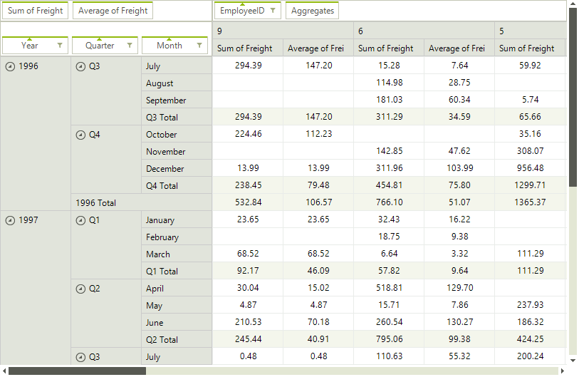
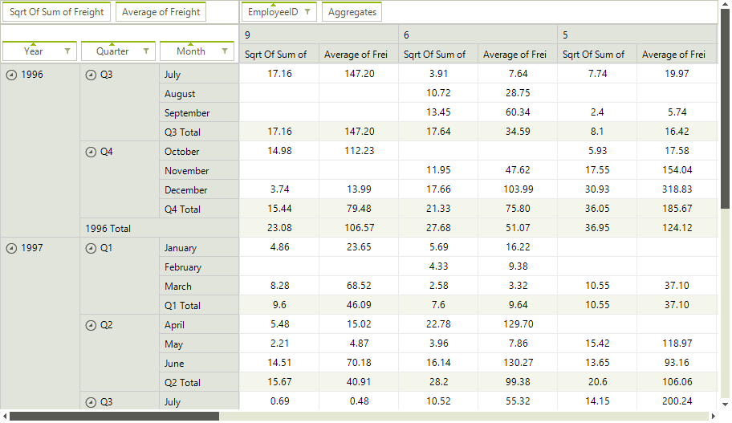
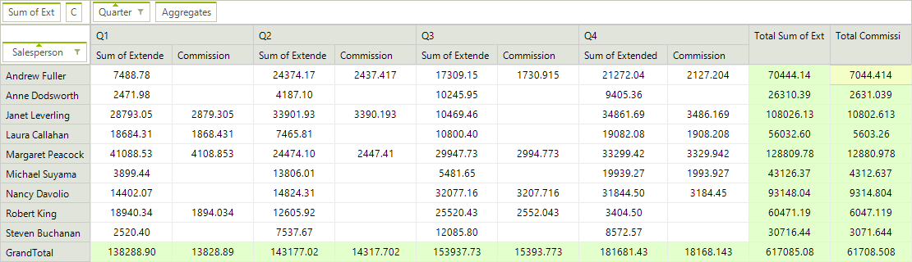

# Custom Aggregation

`RadPivotGrid` in **Progress® Telerik® UI for WinForms** aggregates data and provides an API for custom calculations. This example binds the control to the `Orders` table in the `Northwind` database through a `LocalDataSourceProvider`. For setup details, see [Using LocalDataSourceProvider to Populate RadPivotGrid]().

>caption Figure 1: Using the Built-in *Sum* function

>caption Figure 2: Using the Custom *Sqrt Of Sum* function

## Defining a Custom Aggregation Function

The custom function follows `AggregateFunctions.Sum`, but adds the square roots of the items instead of adding the items themselves.

<snippet id='pivotgrid-sqrtsumaggregatefunction-aggregatefunction-cs' />
<snippet id='pivotgrid-sqrtsumaggregatefunction-aggregatefunction-vb' />

## Defining a Custom Aggregate Value

Create a custom aggregate value class that performs the calculation for the custom function.

<snippet id='pivotgrid-sqrtsumaggregatefunction-aggregatevalue-cs' />
<snippet id='pivotgrid-sqrtsumaggregatefunction-aggregatevalue-vb' />

## Assigning the Custom Function

Assign the custom function to the `AggregateFunction` property of a `PropertyAggregateDescription` object before setting the object on the pivot.

>note The [Custom Dialogs]() article demonstrates how to add the custom function to the **Aggregate Options Dialog**.

<snippet id='pivotgrid-pivotgridcustomaggregation-customfunctionusage-cs' />
<snippet id='pivotgrid-pivotgridcustomaggregation-customfunctionusage-vb' />

>important When you add calculated fields in code-behind, set the `ItemsSource` of `LocalDataSourceProvider` after you add all calculated fields. Alternatively, wrap both the calculated-field additions and the `ItemsSource` assignment in the same `BeginInit`/`EndInit` block or a `using` block that calls `DeferRefresh()` on the provider.
>

>caption Figure 3: Calculated Field in RadPivotGrid

## See Also

* [Calculated Fields]()
* [Calculated Items]()
* [Custom Dialogs]()
* [How to Add Weighted Average in RadPivotGrid]()
