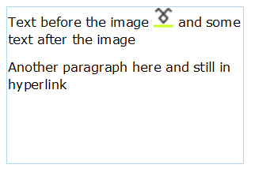

# Hyperlink

Progress® Telerik® UI for WinForms `RadRichTextEditor` supports these hyperlink features:

* Hyperlinks can span several paragraphs.
* Hyperlinks can contain elements such as images, tables, and table elements.
* Hyperlinks can target bookmarks in the document.

Use the [`HyperlinkInfo`](#hyperlinkinfo) and [`HyperlinkRangeStart` and `HyperlinkRangeEnd`](#hyperlinkrangestart-and-hyperlinkrangeend) classes to work with hyperlinks.

[Other customization options](#other-customization-options) let you set the tooltip format and detect hyperlink clicks.
      
## HyperlinkInfo

Most often, use `HyperlinkInfo` objects. These objects have the following properties:

* `IsAnchor` - Determines whether the hyperlink points to a URL or a bookmark.

* `NavigateUri` - Stores the hyperlink URI.

* `Target` - Determines whether the link opens in another window (`HyperlinkTargets.Blank`) or in the same frame (`HyperlinkTargets.Self`).

For example, a link to our site can be inserted in the document programmatically as follows:

<snippet id='richtexteditor-hyperlinkcode-insert-cs' />
<snippet id='richtexteditor-hyperlinkcode-insert-vb' />

A link to a bookmark uses the bookmark name as `NavigateUri` and sets `IsAnchor` to `true`:

<snippet id='richtexteditor-hyperlinkcode-remove-cs' />
<snippet id='richtexteditor-hyperlinkcode-remove-vb' />

You can also use these overloaded methods to insert a hyperlink:

* `public void InsertHyperlink(HyperlinkInfo hyperlinkInfo, string hyperlinkText, StyleDefinition hyperlinkStyle)` - Inserts a hyperlink with a custom style instead of the default blue font color and single underline.
            
* `public void InsertHyperlink(HyperlinkInfo hyperlinkInfo, IEnumerable<Inline> inlines)` - Inserts a hyperlink that spans adjacent inlines, such as bold text or an image.

* `public void InsertHyperlink(HyperlinkInfo hyperlinkInfo)` - Creates a hyperlink from the selected part of the document.
            
* `public void InsertHyperlink(HyperlinkInfo hyperlinkInfo, StyleDefinition hyperlinkStyle)` - Creates a hyperlink from the selected part of the document and applies the specified style.

To remove a hyperlink while keeping its content, place the caret in the hyperlink and call:

<snippet id='richtexteditor-hyperlinkcode-remove-cs' />
<snippet id='richtexteditor-hyperlinkcode-remove-vb' />

## HyperlinkRangeStart and HyperlinkRangeEnd

`HyperlinkRangeStart` and `HyperlinkRangeEnd` are `Inline` document elements. Add them to a document's inlines when you build a `RadDocument` in code.
        
The following example creates a document with a hyperlink that spans several paragraphs and includes an image:

<snippet id='richtexteditor-hyperlinkcode-startend-cs' />
<snippet id='richtexteditor-hyperlinkcode-startend-vb' />

The following image shows a hyperlink that spans several paragraphs and contains an image. Hold `Ctrl` and click the hyperlink to follow it.

Use `HyperlinkRangeStart` and `HyperlinkRangeEnd` when implementing custom hyperlink logic to retrieve document hyperlinks or modify their `HyperlinkInfo` properties or content.
        
The following example deletes all hyperlinks in the document and replaces them with text:

<snippet id='richtexteditor-hyperlinkcode-delete-cs' />
<snippet id='richtexteditor-hyperlinkcode-delete-vb' />

## Other Customization Options

The following options control hyperlink tooltip text and navigation.

### Setting the Tooltip Format

By default, hyperlinks use a fixed tooltip string. The default format is:

>note The default format is `"{0}{1} to follow link"`. The first placeholder represents the URL, and the second represents "Ctrl + Click" from the localization file.

Set `HyperlinkToolTipFormatString` on `RadRichTextEditor` to change the format for all hyperlinks in the document.
        
### Handling Hyperlink Clicks

When a user clicks a hyperlink, `RadRichTextEditor` raises the `HyperlinkClicked` event. The sender is the clicked document element, such as a `Span`, `Image`, or `InlineUIContainer`. `HyperlinkClickedEventArgs` lets you cancel or replace the navigation action. Use the event to validate the hyperlink and prevent navigation to an unsecured address or the start of a local process.

Starting with 2024 Q3 (2024.3.924), hyperlinks open only valid and trusted addresses by default. To cancel navigation, set `Handled` to `true` or `IsTrustedUrl` to `false` on `HyperlinkClickedEventArgs`.

Here is an example of using the `HyperlinkClicked` event prompting that the clicked hyperlink might be unsafe and allows to cancel the navigation process upon receiving the end user confirmation:

<snippet id='richtexteditor-hyperlinkcode-hyperlinkclickedevent-cs' />
<snippet id='richtexteditor-hyperlinkcode-hyperlinkclickedevent-vb' />

### Configuring Hyperlink Navigation

The `HyperlinkNavigationMode` property controls what action triggers hyperlink navigation. It supports these options:

* `CtrlClick` - Triggers the hyperlink when users hold `Ctrl` and click the hyperlink.
* `Click` - Triggers the hyperlink when users click the hyperlink.

The following example changes the default hyperlink navigation mode:

<snippet id='richtexteditor-hyperlinkcode-hyperlinkmode-cs' />
<snippet id='richtexteditor-hyperlinkcode-hyperlinkmode-vb' />

## See Also

 * [Document Elements]()

 * [RadDocument]()

 * [Inline Image]()
