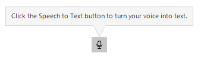

# WinForms SpeechToTextButton Overview

The `RadSpeechToTextButton` control in Progress® Telerik® UI for WinForms lets users enter text by speaking.

When the user clicks the button, the control activates a speech recognition service, listens for voice input, and transcribes the recognized speech into text. The recognized text can then be displayed in a text field, processed by your application logic, or used to trigger specific actions based on voice commands.

The image shows the SpeechToTextButton with a prompt to turn voice into text.

## Prerequisites

To use the SpeechToTextButton in your application, ensure the following requirements are met:

* **Telerik UI for WinForms**: Install the suite and use a valid license.
* **Internet connection**: Provide an active internet connection when using the default online speech recognizer.
* **Microphone access**: Provide the application permission to use a functioning microphone or other audio input device.
* **Default speech recognizer**: The default recognizer uses the Web Speech API through WebView2. Install the `Microsoft.Web.WebView2` NuGet package, or implement a custom recognizer to use another service.

## Key Functionality and Features

The `RadSpeechToTextButton` provides these features:

* **[Speech Recognition]()**: Converts spoken words to text using the Web Speech API through WebView2.
* **[Continuous Recognition](#continuous-vs-one-time-recognition)**: Supports continuous listening mode for extended dictation sessions or one-time recognition for short commands. 
* **[Real-time Transcription]()**: Delivers recognition results as the user speaks.
* **[State Management]()**: Provides visual feedback and access to the recognizer's current state.
* **[Event Handling]()**: Provides events for capturing recognized text and tracking state changes.
* **[Language Configuration](#language-support)**: Lets you set the language used for speech recognition.
* **[Custom Speech Recognizer]()**: Integrates third-party speech recognition services through a custom recognizer.
* **[Styling and Appearance]()**: Lets you customize visual elements and use appearance options inherited from `RadButton`.

## Next Steps

* [Getting Started with Telerik UI for WinForms SpeechToTextButton]()

## Telerik UI for WinForms Learning Resources

* [Telerik UI for WinForms API Reference](https://docs.telerik.com/devtools/winforms/api/)
* [Getting Started with Telerik UI for WinForms Components]()
* [Telerik UI for WinForms Virtual Classroom (Training Courses for Registered Users)](https://learn.telerik.com/learn/course/external/view/elearning/17/TelerikUIforWinForms) 
* [Telerik UI for WinForms Forum](https://www.telerik.com/forums/winforms)
* [Telerik UI for WinForms Knowledge Base](https://docs.telerik.com/devtools/winforms/knowledge-base)

## Telerik UI for WinForms Additional Resources
* [Telerik UI for WinForms Product Overview](https://www.telerik.com/products/winforms.aspx)
* [Telerik UI for WinForms Blog](https://www.telerik.com/blogs/desktop-winforms)
* [Telerik UI for WinForms Videos](https://www.telerik.com/videos/product/winforms)
* [Telerik UI for WinForms Roadmap](https://www.telerik.com/support/whats-new/winforms/roadmap)
* [Telerik UI for WinForms Pricing](https://www.telerik.com/purchase/individual/winforms.aspx)
* [Telerik UI for WinForms Code Library](https://www.telerik.com/support/code-library/winforms)
* [Telerik UI for WinForms Support](https://www.telerik.com/support/winforms)
* [What’s New in Telerik UI for WinForms](https://www.telerik.com/support/whats-new/winforms)
