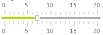
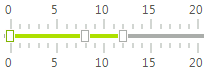
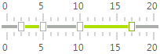

# Modes

**Progress® Telerik® UI for WinForms** `RadTrackBar` supports three modes: `SingleThumb`, `StartFromTheBeginning`, and `Range`. Each mode defines distinct behavior. Set the `TrackBarMode` property to change the mode.

## SingleThumb

In this mode, `RadTrackBar` works like a standard `TrackBar`. It contains one thumb, and you can read its value through the `Value` property. Use the `ValueChanged` event to respond to value changes.

>caption RadTrackBar in SingleThumb mode

## StartFromTheBeginning

In this mode, `RadTrackBar` looks like it does in `SingleThumb` mode, but it can contain more than one thumb. To display multiple thumbs, add the required `TrackBarRange` items to the control's `Ranges` collection. For example:

<snippet id='track-and-status-controls-trackbarpropertiesandevents-trackbarmodestartfromthebeginning-cs' />
<snippet id='track-and-status-controls-trackbarpropertiesandevents-trackbarmodestartfromthebeginning-vb' />

>caption RadTrackBar in StartFromTheBeginning mode

To access the thumb values in this mode, check the `End` property of each `TrackBarRange` in the `Ranges` collection. Although `TrackBarRange` also has a `Start` property, `RadTrackBar` uses only `End` in this mode.

<snippet id='track-and-status-controls-trackbarpropertiesandevents-accessvaluesstartfromthebeginningmode-cs' />
<snippet id='track-and-status-controls-trackbarpropertiesandevents-accessvaluesstartfromthebeginningmode-vb' />

To respond to value changes in this mode, use the `RangeValueChanged` event on `RadTrackBar`:

<snippet id='track-and-status-controls-trackbarpropertiesandevents-ranges_collectionchangedevent-cs' />
<snippet id='track-and-status-controls-trackbarpropertiesandevents-ranges_collectionchangedevent-vb' />

## Range

This mode lets you define one or more ranges with `Start` and `End` values. In this mode, the ranges cannot overlap. To display a second range, add the required `TrackBarRange` to the control's `Ranges` collection. For example:

<snippet id='track-and-status-controls-trackbarpropertiesandevents-trackbarmoderange-cs' />
<snippet id='track-and-status-controls-trackbarpropertiesandevents-trackbarmoderange-vb' />

>caption RadTrackBar in Range mode

To respond to value changes in this mode, use the `RangeValueChanged` event on `RadTrackBar`:

<snippet id='track-and-status-controls-trackbarpropertiesandevents-ranges_collectionchangedevent-cs' />
<snippet id='track-and-status-controls-trackbarpropertiesandevents-ranges_collectionchangedevent-vb' />

>important The `Ranges` collection on `RadTrackBar` contains one default range, which is used to display the default range in all modes. Keep at least one range in the collection. Calling its `Clear` method removes every range except the first one.

>note When you change the mode from `StartFromTheBeginning` to another mode, `RadTrackBar` resets the `Ranges` collection to prevent overlaps, which are not allowed in other modes.

## See Also

* [Structure]()	
* [Design Time]()
* [Getting Started]()	
* [Properties and Events]()	
