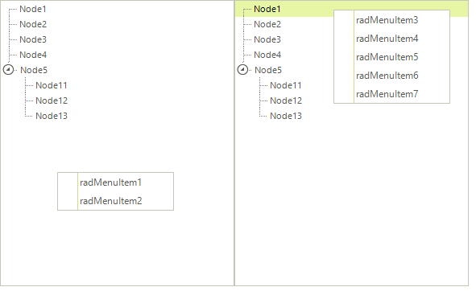

# Custom Context Menus

In Progress® Telerik® UI for WinForms, add a context menu to a `RadTreeView` or to individual nodes. A node's context menu takes precedence over the one assigned to the `RadTreeView`. To add a context menu to a `RadTreeView`, drag a `RadContextMenu` component onto the form, create a `RadContextMenuManager`, and assign the menu to the control's `RadContextMenu` property.

You can assign a `RadContextMenu` instance to an individual node without a `RadContextMenuManager`. For details, see [assigning a RadContextMenu to Telerik and non-Telerik controls](). Use the **RadTreeView Property Builder**:

1. Drag a `RadTreeView` control onto the form.

2. Drag a `RadContextMenu` component onto the form and add several `RadMenuItems` to it.

3. Click the **Smart-Tag** of the `RadContextMenu` instance, then select **Add ContextMenuManager** from the **Action Menu**. The designer adds a `RadContextMenuManager` to the form and makes the `RadContextMenu` property available on the `RadTreeView`.

4. Set the `RadTreeView`'s `RadContextMenu` property to the first `RadContextMenu` instance.

5. Drag another `RadContextMenu` onto the form and add several `RadMenuItems` to it.

6. Open the **RadTreeView Property Builder**. For each desired node, set its `ContextMenu` property to the second `RadContextMenu` instance.

7. Run the project. Right-click a `RadTreeNode` to display its context menu. Right-click elsewhere on the `RadTreeView` to display the first context menu. The image shows both menus.
    
    

## See Also
* [Default Context Menu]()

* [Modifying the Default Context Menu]()
