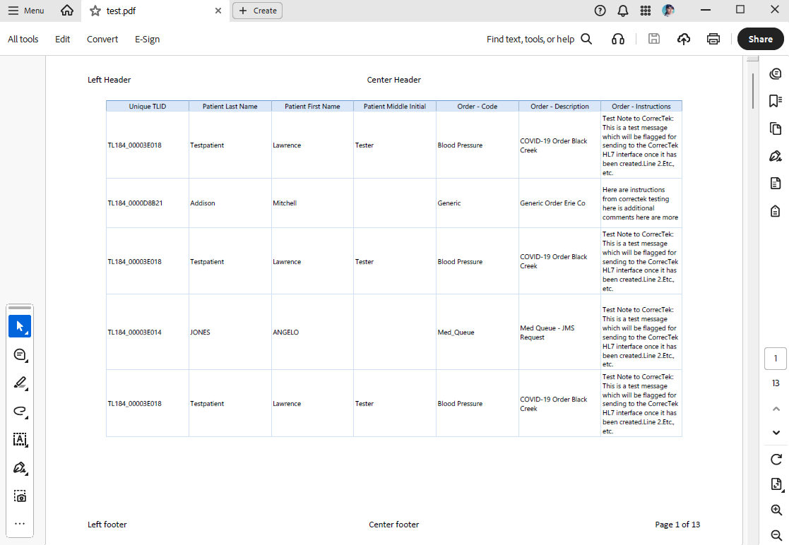

## Environment

The following table identifies the requested environment and validation status:

| Version | Product | Author | 
| ---- | ---- | ---- | 
| 2026.4.1111| RadGridView |[Desislava Yordanova](https://www.telerik.com/blogs/author/desislava-yordanova)| 

## Description

A well-known way to export a `RadGridView` to PDF format is using `GridViewPdfExport`. However, this article shows an alternative approach to achieve the same result with `GridViewSpreadExport` and [RadSpreadProcessing](https://www.telerik.com/document-processing-libraries/documentation/libraries/radspreadprocessing/overview). Configure the workbook to fit all columns within one page width, repeat column titles, and add page headers and footers.

Column inclusion and page layout are separate settings. Use `HiddenOption.ExportAlways` to include hidden columns, then configure the worksheet's page setup to fit the exported columns horizontally.

## Solution

Use `SpreadExportRenderer.WorkbookCreated` to customize the workbook before the exporter saves the PDF. 

### Preparing the Form

Create a Windows Forms project with the required Telerik references and license configuration. For foundational setup, see the [RadGridView setup guide]().

The [spread export configuration]() documents the `Telerik.UI.for.WinForms.Export` package and these assemblies:

* `TelerikExport.dll`
* `Telerik.Windows.Documents.Core.dll`
* `Telerik.Windows.Documents.Fixed.dll`
* `Telerik.Windows.Documents.Spreadsheet.dll`
* `Telerik.Windows.Documents.Spreadsheet.FormatProviders.OpenXml.dll`
* `Telerik.Windows.Documents.Spreadsheet.FormatProviders.Pdf.dll`
* `Telerik.Windows.Zip.dll`

Use matching assembly versions for the selected Telerik release. Assembly filenames and namespaces are different identifiers.

Set up the example form as follows:

1. Add a `RadGridView` and populate it with data.
2. Add a button and set its text to **Export PDF**.
3. Start with an empty grid and no designer-configured data sources or columns.

````C#
        public Form1()
        {
            InitializeComponent();
            DataTable dt = new DataTable();
            dt.Columns.Add("Unique TLID", typeof(string));
            dt.Columns.Add("Patient Last Name", typeof(string));
            dt.Columns.Add("Patient First Name", typeof(string));
            dt.Columns.Add("Patient Middle Initial", typeof(string));
            dt.Columns.Add("Order - Code", typeof(string));
            dt.Columns.Add("Order - Description", typeof(string));
            dt.Columns.Add("Order - Instructions", typeof(string));
            for (int i = 0; i < 64; i++)
            {
                if (i % 2 == 0)
                    dt.Rows.Add("TL184_00003E018", "Testpatient", "Lawrence", "Tester", "Blood Pressure", "COVID-19 Order Black Creek", "Test Note to CorrecTek: This is a test message which will be flagged for sending to the CorrecTek HL7 interface once it has been created.Line 2.Etc., etc.");
                else if (i % 3 == 0)
                    dt.Rows.Add("TL184_00003E014", "JONES", "ANGELO", "", "Med_Queue", "Med Queue - JMS Request", "                                                                    Test Note to CorrecTek: This is a test message which will be flagged for sending to the CorrecTek HL7 interface once it has been created.Line 2.Etc., etc.");
                else if (i % 5 == 0)
                    dt.Rows.Add("TL184_0000D8BB0", "Tester", "Jerry", "Aaron", "Blood Sugar", "Blood Sugar", "                                                                                                                                                                                                                                                                                                                                                     MODERATE DOSE SCALE\r\nUse Regular Insulin for Sliding Scale BS > 199\r\n\r\nBlood Sugar Readings:\r\n< 199:  0 units\r\n200 - 250:  2 units SQ\r\n351 - 300:  4 units SQ\r\n301 - 350:  6 units SQ\r\n351 - 400:  8 units SQ\r\n401 - 450:  10 units SQ\r\n451 - 500:  12 units SQ\r\n> 500:  Call Medical Provider                                                                                                                                                                                                                                                                                                                   ");
                else
                    dt.Rows.Add("TL184_0000D8B21", "Addison", "Mitchell", "", "Generic", "Generic Order Erie Co", "Here are instructions from correctek testing here is additional comments here are more");
            }
            dt.Rows.Add("TOTALS (" + dt.Rows.Count.ToString() + ")");

            radGridView1.AutoSizeRows = true;
            radGridView1.DataSource = dt;
            radGridView1.AutoSizeColumnsMode = Telerik.WinControls.UI.GridViewAutoSizeColumnsMode.Fill;
            foreach (var item in radGridView1.Columns)
            {
                item.WrapText = true;
            }

            button1.Click += button1_Click;
        }
````

### Configuring the PDF Export

Add these handlers to the form. The constructor already subscribes to the button event. 

Configure the export and page layout as follows:

1. Set `ExportFormat` to `SpreadExportFormat.Pdf` and `ExportVisualSettings` to `true`.
2. Set `HiddenColumnOption` to `HiddenOption.ExportAlways` to include hidden columns.
3. Subscribe to `WorkbookCreated` before calling `RunExport()`.
4. Configure A4 landscape pages and fit the worksheet to one page wide without a fixed page height.
5. Configure the first worksheet row as repeated column titles and set the page header/footer text.

The inspected source uses `HeaderContents.DefaultContent` and `FooterContents.DefaultContent` for header/footer sections. The handlers adapt the supplied `Header` and `Footer` access accordingly.

The output path `..\..\test.pdf` is relative to the process's working directory. Use an existing, writable destination directory.

>important The export can overwrite an existing `test.pdf`. Choose a different filename to preserve an earlier export.

````C#
private void button1_Click(object sender, EventArgs e)
{
    GridViewSpreadExport pdfExporter = new GridViewSpreadExport(radGridView1);
    SpreadExportRenderer renderer = new SpreadExportRenderer();
    renderer.WorkbookCreated += ExportRenderer_WorkbookCreated;

    pdfExporter.ExportFormat = SpreadExportFormat.Pdf;
    pdfExporter.ExportVisualSettings = true;
    pdfExporter.HiddenColumnOption = Telerik.WinControls.UI.Export.HiddenOption.ExportAlways;

    try
    {
        pdfExporter.RunExport(@"..\..\test.pdf", renderer);
        MessageBox.Show("PDF file was exported successfully.");
    }
    catch (IOException exception)
    {
        MessageBox.Show("PDF export failed: " + exception.Message);
    }
    catch (UnauthorizedAccessException exception)
    {
        MessageBox.Show("PDF export failed: " + exception.Message);
    }
}

private void ExportRenderer_WorkbookCreated(object sender, WorkbookCreatedEventArgs e)
{
    Worksheet worksheet = e.Workbook.Worksheets[0];
    WorksheetPageSetup pageSetup = worksheet.WorksheetPageSetup;

    pageSetup.PrintTitles.RepeatedRows = new RowRange(0, 0);

    var footer = pageSetup.HeaderFooterSettings.FooterContents.DefaultContent;
    footer.LeftSection.Text = "Left footer";
    footer.CenterSection.Text = "Center footer";
    footer.RightSection.Text = "Page &P of &N";

    var header = pageSetup.HeaderFooterSettings.HeaderContents.DefaultContent;
    header.LeftSection.Text = "Left header";
    header.CenterSection.Text = "Center header";

    pageSetup.PaperType = PaperTypes.A4;
    pageSetup.PageOrientation = PageOrientation.Landscape;
    pageSetup.CenterHorizontally = true;
    pageSetup.FitToPages = true;
    pageSetup.FitToPagesWide = 1;
    pageSetup.FitToPagesTall = 0;
}
````

`FitToPagesWide = 1` and `FitToPagesTall = 0` select fit-to-width scaling rather than a single-page export. The document can extend over multiple pages vertically.

`HiddenOption.DoNotExport`excludes hidden columns. Use it only when the intended result includes visible columns alone.

>caption PDF export result with all seven columns, page headers and footers, and page numbering



## See Also

* [RadGridView spread export options]()
* [Customizing exported worksheet headers and footers]()
