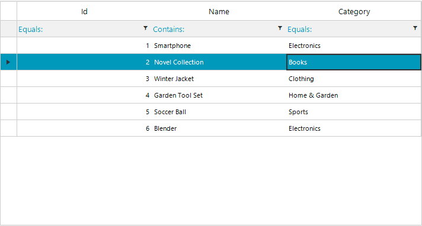
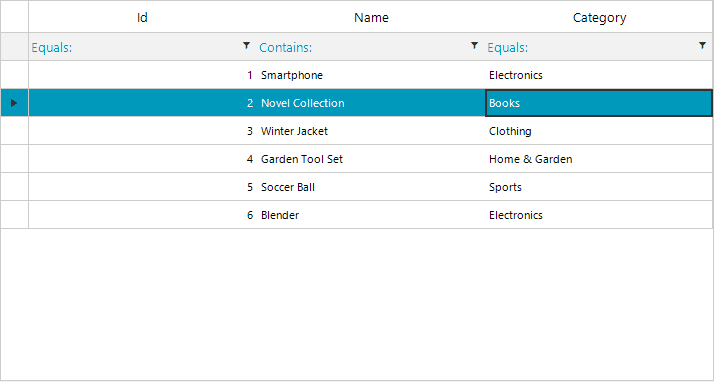

## Environment

| Version | Product | Author | 
| ---- | ---- | ---- | 
| 2026.3.1007| RadGridView |[Desislava Yordanova](https://www.telerik.com/blogs/author/desislava-yordanova)| 

## Description

When you clear the text in an editable `GridViewMultiComboBoxColumn` cell while filtering is enabled, the editor can select the first filtered result. This example uses a custom `RadMultiColumnComboBoxElement` editor to keep the cell empty until you select a row with the mouse or press `Enter`.

The data model must allow an empty value. This example uses a nullable `int?` for `Product.CategoryId`.

>caption Figure 1: Default selection returns after the filter text is cleared.



## Solution

The following example replaces the generated `CategoryId` column with a `GridViewMultiComboBoxColumn` and uses a custom editor to handle empty text. The `NullableMultiColumnComboBoxElement` clears the current row when its text becomes empty. While the text remains empty, its `CurrentRowChanging` handler cancels row changes unless the user explicitly selects a data row with the mouse or presses `Enter`. The event handlers are removed when editing ends so they do not remain attached after the edit session.

After applying the example, clear a category cell and commit the edit. The cell must remain empty. Selecting a category from the popup with the mouse or pressing `Enter` sets its value.

```csharp
using System;
using System.Collections.Generic;
using System.ComponentModel;
using System.Windows.Forms;
using Telerik.WinControls;
using Telerik.WinControls.Data;
using Telerik.WinControls.UI;

public partial class MultiComboGridForm : RadForm
{
    private readonly List<Category> categories;
    private readonly BindingList<Product> products;

    public MultiComboGridForm()
    {
        InitializeComponent();

        this.categories = GetCategories();
        this.products = GetProducts();

        this.radGridView1.DataSource = this.products;
        this.ConfigureGridColumns();
    }

    private List<Category> GetCategories()
    {
        return new List<Category>
        {
            new Category(1, "Electronics"),
            new Category(2, "Books"),
            new Category(3, "Clothing"),
            new Category(4, "Home & Garden"),
            new Category(5, "Sports"),
            new Category(6, "Toys"),
            new Category(7, "Automotive"),
            new Category(8, "Groceries")
        };
    }

    private BindingList<Product> GetProducts()
    {
        return new BindingList<Product>
        {
            new Product(1, "Smartphone", 1),
            new Product(2, "Novel Collection", 2),
            new Product(3, "Winter Jacket", 3),
            new Product(4, "Garden Tool Set", 4),
            new Product(5, "Soccer Ball", 5),
            new Product(6, "Blender", 1)
        };
    }

    private void ConfigureGridColumns()
    {
        this.radGridView1.Columns["Id"].HeaderText = "Id";
        this.radGridView1.Columns["Name"].HeaderText = "Name";

        if (this.radGridView1.Columns["CategoryId"] != null)
        {
            this.radGridView1.Columns.Remove(this.radGridView1.Columns["CategoryId"]);
        }

        GridViewMultiComboBoxColumn categoriesColumn = new GridViewMultiComboBoxColumn
        {
            HeaderText = "Category",
            FieldName = "CategoryId",
            DataSource = this.categories,
            ValueMember = "Id",
            DisplayMember = "Name",
            AutoSizeMode = BestFitColumnMode.AllCells,
            DropDownStyle = RadDropDownStyle.DropDown
        };

        this.radGridView1.Columns.Add(categoriesColumn);
        this.radGridView1.EditorRequired += this.RadGridView1_EditorRequired;
        this.radGridView1.CellEditorInitialized += this.RadGridView1_CellEditorInitialized;
    }

    private void RadGridView1_EditorRequired(object sender, EditorRequiredEventArgs e)
    {
        if (this.radGridView1.CurrentColumn is GridViewMultiComboBoxColumn)
        {
            e.Editor = new NullableMultiColumnComboBoxElement();
        }
    }

    private void RadGridView1_CellEditorInitialized(object sender, GridViewCellEventArgs e)
    {
        if (!(this.radGridView1.CurrentColumn is GridViewMultiComboBoxColumn))
        {
            return;
        }

        RadMultiColumnComboBoxElement editor = this.radGridView1.ActiveEditor as RadMultiColumnComboBoxElement;
        if (editor == null)
        {
            return;
        }

        editor.AutoSizeDropDownToBestFit = true;
        editor.AutoFilter = true;
        editor.AutoFilterDelay = 100;

        editor.EditorControl.EnableFiltering = true;
        editor.EditorControl.ShowFilteringRow = false;
        editor.EditorControl.MasterTemplate.FilterDescriptors.Clear();
        editor.EditorControl.MasterTemplate.FilterDescriptors.Add(
            new FilterDescriptor("Name", FilterOperator.Contains, string.Empty));
    }
}

public class NullableMultiColumnComboBoxElement : RadMultiColumnComboBoxElement
{
    public bool ClosedByRowSelection { get; private set; }

    protected override Type ThemeEffectiveType
    {
        get { return typeof(RadMultiColumnComboBoxElement); }
    }

    public override void BeginEdit()
    {
        this.EditorControl.CurrentRowChanging -= this.EditorControl_CurrentRowChanging;
        base.BeginEdit();

        this.TextChanged -= this.NullableMultiColumnComboBoxElement_TextChanged;
        this.TextChanged += this.NullableMultiColumnComboBoxElement_TextChanged;
    }

    protected override void OnPopupOpening(System.ComponentModel.CancelEventArgs e)
    {
        base.OnPopupOpening(e);

        this.ClosedByRowSelection = false;
        this.EditorControl.MouseDown -= this.EditorControl_RowSelected;
        this.EditorControl.MouseDown += this.EditorControl_RowSelected;
        this.EditorControl.KeyDown -= this.EditorControl_KeyDown;
        this.EditorControl.KeyDown += this.EditorControl_KeyDown;
    }

    protected override void OnPopupClosing(RadPopupClosingEventArgs e)
    {
        this.EditorControl.MouseDown -= this.EditorControl_RowSelected;
        this.EditorControl.KeyDown -= this.EditorControl_KeyDown;

        base.OnPopupClosing(e);
    }

    private void EditorControl_RowSelected(object sender, MouseEventArgs e)
    {
        RadGridView grid = sender as RadGridView;
        if (grid == null || e.Button != MouseButtons.Left)
        {
            return;
        }

        RadElement element = grid.ElementTree.GetElementAtPoint(e.Location);
        GridDataCellElement cell = element as GridDataCellElement;
        if (cell == null && element != null)
        {
            cell = element.FindAncestor<GridDataCellElement>();
        }

        if (cell != null && cell.RowInfo is GridViewDataRowInfo)
        {
            this.ClosedByRowSelection = true;
        }
    }

    private void EditorControl_KeyDown(object sender, KeyEventArgs e)
    {
        if (e.KeyCode == Keys.Enter)
        {
            RadGridView grid = sender as RadGridView;
            if (grid != null && grid.CurrentRow is GridViewDataRowInfo)
            {
                this.ClosedByRowSelection = true;
            }
        }
    }

    private void NullableMultiColumnComboBoxElement_TextChanged(object sender, EventArgs e)
    {
        if (!string.IsNullOrEmpty(this.Text))
        {
            return;
        }

        // Clear any prior handler before resetting the current row, then block
        // automatic row changes while the editor text remains empty.
        this.EditorControl.CurrentRowChanging -= this.EditorControl_CurrentRowChanging;
        this.SelectedIndex = -1;
        this.EditorControl.ClearSelection();
        this.EditorControl.CurrentRow = null;
        this.EditorControl.CurrentRowChanging += this.EditorControl_CurrentRowChanging;
    }

    private void EditorControl_CurrentRowChanging(object sender, CurrentRowChangingEventArgs e)
    {
        if (string.IsNullOrEmpty(this.Text))
        {
            e.Cancel = !this.ClosedByRowSelection;
        }
    }

    public override bool EndEdit()
    {
        this.TextChanged -= this.NullableMultiColumnComboBoxElement_TextChanged;
        this.EditorControl.CurrentRowChanging -= this.EditorControl_CurrentRowChanging;
        this.EditorControl.MouseDown -= this.EditorControl_RowSelected;
        this.EditorControl.KeyDown -= this.EditorControl_KeyDown;

        return base.EndEdit();
    }
}

public class Category
{
    public int Id { get; set; }
    public string Name { get; set; }

    public Category(int id, string name)
    {
        this.Id = id;
        this.Name = name;
    }
}

public class Product
{
    public int Id { get; set; }
    public string Name { get; set; }
    public int? CategoryId { get; set; }

    public Product(int id, string name, int? categoryId)
    {
        this.Id = id;
        this.Name = name;
        this.CategoryId = categoryId;
    }
}
```

>caption Figure 2: The category cell remains empty after its filter text is cleared.



>note The `Category` and `Product` model classes are top-level types in this example. `Product.CategoryId` must be nullable (or otherwise accept `null`) for an empty cell value to be stored.

## See Also

* [Editing Lifecycle]()
* [Handling Editors' events]()
* [Filtering]()