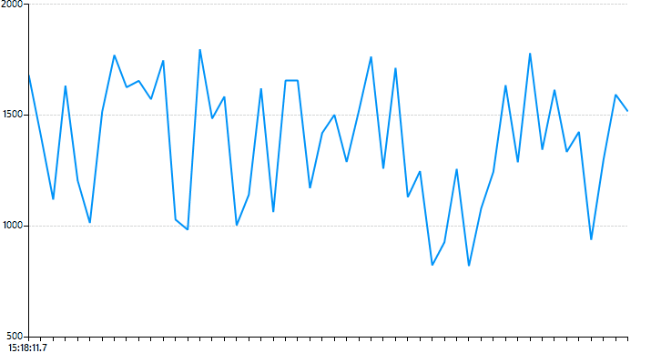

## Environment

| Version | Product | Author | 
| ---- | ---- | ---- | 
| 2026.3.1007| RadChartView |[Desislava Yordanova](https://www.telerik.com/blogs/author/desislava-yordanova)| 

## Description

This article shows how to bind a **RadChartView** line series to a `BindingList<T>` and update the chart as new data arrives. The example uses a Windows Forms timer to keep a rolling window of 50 points: on each tick, it removes the oldest point and adds a new one.



## Solution

Bind the series to a list and set `CategoryMember` and `ValueMember` to the names of the corresponding data-object properties. A `BindingList<T>` notifies the chart when items are added or removed. The timer in this example is a Windows Forms timer, so its tick handler updates the list from the UI thread.

After each timer tick, the bound list contains 50 points, and the chart displays the latest rolling data. Change the timer interval to match the incoming data rate. A shorter interval does not guarantee that the chart can render at that rate.

The example replaces whole items. If you instead change a property on an existing item and want the chart to reflect that change, implement `INotifyPropertyChanged` on the item type. See [Binding to BindingList]() for details.

For large data sets or frequent updates, evaluate the update rate and data retention strategy. `FastLineSeries` can improve performance when displaying thousands of points, but it does not display data point labels or plot points. See [FastLine]() and [Tips and Tricks to Optimize RadChartView's Performance]().

````C#
    public partial class LiveChartData : Telerik.WinControls.UI.RadForm
    {
        private LiveDataModel model = new LiveDataModel();
        private Font font = new Font("Segoe UI", 12F);
        public LiveChartData()
        {
            InitializeComponent();
            Type seriesType = typeof(FastLineSeries);
            CartesianArea area = this.radChartView1.GetArea<CartesianArea>();
            CartesianGrid grid = area.GetGrid<CartesianGrid>();
            grid.DrawVerticalStripes = false;
            grid.DrawHorizontalStripes = true;
            grid.DrawHorizontalFills = false;
            grid.DrawVerticalFills = false;
            area.ShowGrid = true;

            LineSeries lineSeries;

            if (seriesType == typeof(FastLineSeries))
            {
                lineSeries = new FastLineSeries();
                lineSeries.BorderColor = Color.FromArgb(0, 147, 249);
            }
            else
            {
                lineSeries = new LineSeries();
                lineSeries.BorderColor = Color.FromArgb(142, 196, 65);
            }

            lineSeries.PointSize = new SizeF(0, 0);
            lineSeries.CategoryMember = "Category";
            lineSeries.ValueMember = "Value";
            lineSeries.DataSource = this.model.Data;
            lineSeries.BorderWidth = 2;

            this.radChartView1.Series.Add(lineSeries);

            this.radChartView1.ChartElement.TitlePosition = TitlePosition.Top;
            this.radChartView1.ChartElement.TitleElement.TextAlignment = ContentAlignment.MiddleLeft;
            this.radChartView1.ChartElement.TitleElement.Margin = new Padding(10, 10, 0, 0);
            this.radChartView1.ChartElement.TitleElement.Font = this.font;
            this.radChartView1.View.Margin = new Padding(10, 0, 35, 0);

            LinearAxis axeY = radChartView1.Axes.Get<LinearAxis>(1);
            axeY.Minimum = 500;
            axeY.Maximum = 2000;
            axeY.MajorStep = 500;

            CategoricalAxis axeX = radChartView1.Axes.Get<CategoricalAxis>(0);
            axeX.ClipLabels = false;
            axeX.LabelInterval = 50;
            axeX.LabelFormat = "{0:HH:mm:ss.f}";
        }

        protected override void OnLoad(EventArgs e)
        {
            base.OnLoad(e);
            this.model.StartTimer(); 
        }
    }
    public class LiveDataModel : INotifyPropertyChanged
    {
        public BindingList<ChartBusinessObject> data;
        private string fps;
        private string messagesPerSecond;
        private string messagesPerMinute;
        private int tickCountSecond;
        private int tickCountMinute;
        private Timer timer;
        private DateTime lastDate;
        private Random random = new Random();
        private DateTime tmpDateTime = DateTime.MinValue;
        private int count = 0;

        public class ChartBusinessObject
        {
            private double value;
            private DateTime category;

            public double Value
            {
                get
                {
                    return this.value;
                }
                set
                {
                    this.value = value;
                }
            }

            public DateTime Category
            {
                get
                {
                    return this.category;
                }
                set
                {
                    this.category = value;
                }
            }
        }
        public LiveDataModel()
        {
            this.timer = new Timer();
            this.timer.Interval = 50;
            this.timer.Tick += this.OnTimer;

            this.FillData();
            this.MessagesPerSecond = this.random.Next(800, 1800).ToString("#,#");
            this.MessagesPerMinute = this.random.Next(50000, 55000).ToString("#,#");
        }

        public string FPS
        {
            get
            {
                return this.fps;
            }
            set
            {
                if (this.fps != value)
                {
                    this.fps = value;
                    this.OnPropertyChanged("FPS");
                }
            }
        }

        public string MessagesPerSecond
        {
            get
            {
                return this.messagesPerSecond;
            }
            set
            {
                if (this.messagesPerSecond != value)
                {
                    this.messagesPerSecond = value;
                    this.OnPropertyChanged("MessagesPerSecond");
                }
            }
        }

        public string MessagesPerMinute
        {
            get
            {
                return this.messagesPerMinute;
            }
            set
            {
                if (this.messagesPerMinute != value)
                {
                    this.messagesPerMinute = value;
                    this.OnPropertyChanged("MessagesPerMinute");
                }
            }
        }

        public BindingList<ChartBusinessObject> Data
        {
            get
            {
                return this.data;
            }
            set
            {
                if (this.data != value)
                {
                    this.data = value;
                    this.OnPropertyChanged("Data");
                }
            }
        }

        public void StartTimer()
        {
            this.timer.Start();
        }

        public void StopTimer()
        {
            this.timer.Stop();
        }

        public void UpdateTimer(double interval)
        {
            this.timer.Interval = (int)interval;
        }

        private void FillData()
        {
            BindingList<ChartBusinessObject> collection = new BindingList<ChartBusinessObject>();
            this.lastDate = DateTime.Now;

            for (int i = 0; i < 50; i++)
            {
                this.lastDate = this.lastDate.AddMilliseconds(200);
                collection.Add(this.CreateBusinessObject());
            }

            this.Data = collection;
        }

        private void OnTimer(object sender, EventArgs e)
        {
            DateTime now = DateTime.Now;
            if ((now - tmpDateTime).TotalSeconds > 1)
            {
                tmpDateTime = now;
                if (count != 0)
                {
                    this.FPS = (count / 1).ToString();
                }

                count = 0;
            }
            else
            {
                count++;
            }

            this.lastDate = this.lastDate.AddMilliseconds(200);
            this.Data.RemoveAt(0);
            this.Data.Add(this.CreateBusinessObject());
            this.UpdateMetrics();
        }

        private void UpdateMetrics()
        {
            this.tickCountSecond++;
            this.tickCountMinute++;

            if (this.tickCountSecond == 5)
            {
                this.tickCountSecond = 0;
                this.MessagesPerSecond = this.random.Next(800, 1800).ToString("#,#");
            }

            if (this.tickCountMinute == 100)
            {
                this.tickCountMinute = 0;
                this.MessagesPerMinute = this.random.Next(50000, 55000).ToString("#,#");
            }
        }

        private ChartBusinessObject CreateBusinessObject()
        {
            ChartBusinessObject obj = new ChartBusinessObject();

            obj.Value = this.random.Next(800, 1800);
            obj.Category = this.lastDate;

            return obj;
        }

        private ChartBusinessObject CreateBusinessObject2(DateTime date)
        {
            ChartBusinessObject obj = new ChartBusinessObject();

            obj.Value = this.random.Next(3300, 3800);
            obj.Category = date;

            return obj;
        }

        public event PropertyChangedEventHandler PropertyChanged;

        protected virtual void OnPropertyChanged(string propertyName)
        {
            if (this.PropertyChanged != null)
            {
                this.PropertyChanged(this, new PropertyChangedEventArgs(propertyName));
            }
        }

    }

````

## See Also

* [Populating with Data]()
* [Binding to BindingList]()
* [FastLine]()
