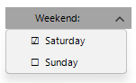

## Environment

| Version | Product | Author | 
| ---- | ---- | ---- | 
| 2026.3.1007| RadMenu |[Desislava Yordanova](https://www.telerik.com/blogs/author/desislava-yordanova)| 

## Description

To keep a normal `RadMenuItem`'s `IsChecked`, `ToggleState`, and `CheckOnClick` behavior while displaying your own checkbox glyphs, update the item's `Text` when its toggle state changes and collapse `Layout.Checkmark` after the state change. This preserves the standard menu item visual tree.



## Solution

Call the following method after `InitializeComponent()` for each checkable item. The method sets the initial text and hides the built-in checkmark. It then updates the text and hides the checkmark again after each `ToggleStateChanged` event.

````C#

using System;
using Telerik.WinControls;
using Telerik.WinControls.UI;

private void ConfigureCheckableItem(RadMenuItem item, string label)
{
    item.CheckOnClick = true;

    Action updateVisual = () =>
    {
        item.Text = $"{(item.IsChecked ? "☑" : "☐")}  {label}";
        item.Layout.Checkmark.Visibility = ElementVisibility.Collapsed;
    };

    item.ToggleStateChanged += (sender, args) => updateVisual();
    updateVisual();
}

public Form1()
{
    InitializeComponent();

    RadMenuItem saturday = new RadMenuItem();
    this.radDropDownButton1.Items.Add(saturday);
    RadMenuItem sunday = new RadMenuItem();
    this.radDropDownButton1.Items.Add(sunday);

    ConfigureCheckableItem(saturday, "Saturday");
    ConfigureCheckableItem(sunday, "Sunday");

}

````

The menu items remain ordinary `RadMenuItem` instances. The method does not replace the built-in layout or change how the application reads `IsChecked` or `ToggleState`. `CheckOnClick` continues to toggle the item when it is selected from a drop-down menu.

`Layout.Checkmark` also contains the image element used in the item's left column. This technique is for menu items that do not need a separate item image in that column. The custom glyphs are Unicode text. Check that the font used by your application can display them.

## See Also

* [RadMenuItem properties and behavior]()
* [RadMenuItem toggle events]()
* [RadMenu structure]()
