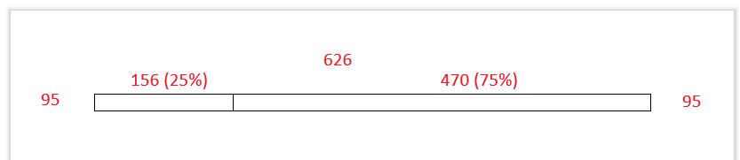

## Environment

| Version | Product | Author | 
| ---- | ---- | ---- | 
| 2026.4.1111| RadRichTextEditor |[Desislava Yordanova](https://www.telerik.com/blogs/author/desislava-yordanova)| 

## Description

Use this example to set table column widths as percentages of the page content width. The code calculates that width from the page width and the document's default side margins.

The following image shows a table with a 25% first column and a 75% second column within the page content area.



## Solution

The method creates a new document with a two-column table. It calculates the page content width, then sets the column preferred widths to 25% and 75% of that width.

Set the table's `LayoutMode` property to `TableLayoutMode.Fixed` so the table uses the preferred column widths.

```C#
using Telerik.WinControls.UI;
using Telerik.WinForms.Documents.Model;

private static void SetTableColumnWidths(RadRichTextEditor editor)
{
    RadDocument document = new RadDocument();
    Section section = new Section();
    Table table = new Table();
    table.StyleName = RadDocumentDefaultStyles.DefaultTableGridStyleName;
    table.LayoutMode = TableLayoutMode.Fixed;

    double pageWidth = section.PageSize.Width;
    double leftMargin = document.SectionDefaultPageMargin.Left;
    double rightMargin = document.SectionDefaultPageMargin.Right;
    double contentWidth = pageWidth - leftMargin - rightMargin;

    double firstColumnWidth = contentWidth * 0.25;
    double secondColumnWidth = contentWidth * 0.75;

    TableRow row = new TableRow();
    table.Rows.Add(row);

    TableCell firstCell = new TableCell();
    firstCell.PreferredWidth = new TableWidthUnit(TableWidthUnitType.Fixed, firstColumnWidth);

    TableCell secondCell = new TableCell();
    secondCell.PreferredWidth = new TableWidthUnit(TableWidthUnitType.Fixed, secondColumnWidth);

    row.Cells.Add(firstCell);
    row.Cells.Add(secondCell);

    section.Blocks.Add(table);
    document.Sections.Add(section);

    editor.Document = document;
}
```

The code stores each calculated value as a fixed width in document layout units. It calculates the percentages from the page content width instead of using `TableWidthUnitType.Percent`.

## Notes

The example uses the document's default page size and margins. Adjust the calculation if you set custom page settings on the section. The method assigns a new document to the editor, replacing its current document.

You can also set percentage widths directly with `Table.SetGridColumnWidth()`. This alternative uses the width available to the table during layout as its percentage basis. Keep `table.LayoutMode` set to `TableLayoutMode.Fixed`, then replace the `PreferredWidth` assignments with:

```C#
table.SetGridColumnWidth(0, new TableWidthUnit(TableWidthUnitType.Percent, 25));
table.SetGridColumnWidth(1, new TableWidthUnit(TableWidthUnitType.Percent, 75));
```

## See Also

* [Table creation and formatting options]()
