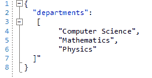

# Enabling JSON Array Folding in RadSyntaxEditor

## Environment

| Version | Product | Author | 
| ---- | ---- | ---- | 
| 2026.3.1007| RadSyntaxEditor |[Desislava Yordanova](https://www.telerik.com/blogs/author/desislava-yordanova)| 

## Description

A JSON list, or array, may have syntax highlighting in `RadSyntaxEditor` without a collapsible region. Use `SquareBracketFoldingTagger` to create folding regions for multiline JSON arrays and objects.

This article covers missing folding regions caused by tagger configuration or single-line content. It does not provide a fix for regions that collapse the wrong text.

>caption Figure 1: JSON Array Folding in RadSyntaxEditor



## Solution

`JsonTagger` provides syntax highlighting, not folding. `BracketFoldingTagger` matches curly braces (`{}`) by default, whereas `SquareBracketFoldingTagger` handles both square brackets (`[]`) and curly braces.

Check the following conditions before you test folding:

1. Register `SquareBracketFoldingTagger` in the editor's `TaggersRegistry`. A registered `JsonTagger` does not replace the folding tagger.
2. Place the array's opening and closing brackets on different lines. A single-line array does not receive a folding region from this tagger.
3. Use a multiline JSON document to check that the array receives its own folding region.

The example adapts the registration pattern used by the JSON folding test. Add the imports and method to a form that contains `radSyntaxEditor1`. Call `ConfigureJsonFolding` once after `InitializeComponent`, in place of any existing folding-tagger setup for this editor. The method replaces the editor's document with sample data.

```C#
using Telerik.WinControls.UI.Taggers.Folding;
using Telerik.WinForms.SyntaxEditor.Core.Text;

private void ConfigureJsonFolding()
{
    var foldingTagger = new SquareBracketFoldingTagger(
        this.radSyntaxEditor1.SyntaxEditorElement);
    this.radSyntaxEditor1.TaggersRegistry.RegisterTagger(foldingTagger);

    string json = "{\n" +
        "  \"departments\": [\n" +
        "    \"Computer Science\",\n" +
        "    \"Mathematics\",\n" +
        "    \"Physics\"\n" +
        "  ]\n" +
        "}";

    this.radSyntaxEditor1.Document = new TextDocument(json);
}
```

After the editor updates its folding regions, the sample has a region for the outer object and another for the `departments` array. The example configures folding only. Keep your `JsonTagger` registration if you also need syntax highlighting.

>note An array whose opening and closing brackets are on the same line remains inline, even when its surrounding object spans multiple lines.

## See Also

* [SyntaxEditor tagger registration]()
* [Built-in folding taggers and customization]()
* [Collapsing and expanding existing folding regions]()