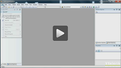
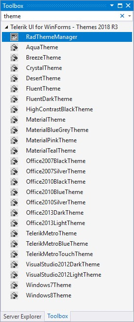
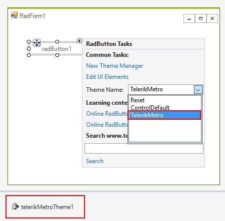
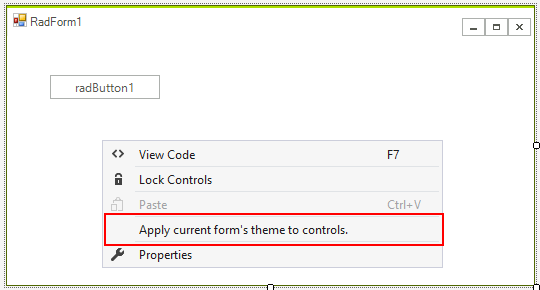

# Using default themes 

All themes that come with Telerik UI for WinForms since version R2 2008 are available as standalone components, apart from the control's assemblies. This improvement has been added in order to simplify the way themes are added to the application and to improve the application’s loading time.

## Related Video

[Applying themes to RadControls for WinForms at the control and form level](http://tv.telerik.com/watch/winforms/themes/radcontrols-winforms-theme) introduces theme selection for individual controls and forms.



For written instructions instead of the video, follow [Apply a theme to a control](#apply-a-theme-to-a-control) and [Apply a theme to all controls in the current form](#applying-theme-to-all-controls-in-the-current-form) below.

## Apply a theme to a control

If you have installed the suite from the provided installation files, you will see the themes loaded in the Visual Studio (VS) toolbox. If you do not see them, [add the theme components to the Visual Studio toolbox]().

>caption Figure 1: The themes in the Visual Studio toolbox.



>note Since R2 2020, the **ControlDefault** theme offers Scalable Vector Graphics (SVG) images as well as raster images. SVG images are displayed by default. See [Vector Images]() to choose which image type to display.

>note Since R1 2021 Telerik UI for Winforms suite has introduced the brand new **Office2019Light** theme. Inspired by the latest Microsoft Office application, the **Office2019Light** theme is here to help delivering that fresh look and feel to your WinForms application. As of **R2 2021** there are Gray and Dark variations of the Office2019 theme.

>note Since R2 2023 Telerik UI for WinForms suite introduced **VisualStudio2022Dark** theme.

>note Since R1 2022 Telerik UI for WinForms suite introduced **VisualStudio2022** theme inspired by the last released version of Visual Studio.

1. Drag the desired theme component from the VS Toolbox to the form. This adds a reference to the corresponding theme assembly in the project and makes the theme available in the **ThemeName** drop-down of all Telerik controls on the form.
1. Select the theme from the control's **ThemeName** drop-down in the smart tag, or set **ThemeName** programmatically.

>caption Figure 2: Set the theme at design time using the SmartTag.



## Setting a default theme for a whole application programmatically

Before using the following code snippets, add the desired theme's dynamic-link library (DLL) file to your project references.

### Setting a default theme for the entire application

Create the theme component and set **ThemeResolutionService.ApplicationThemeName** as shown below.

{{source=..\SamplesCS\Themes\UsingDefaultThemes.cs region=usingDefaultThemes}} 
{{source=..\SamplesVB\Themes\UsingDefaultThemes.vb region=usingDefaultThemes}} 

````C#
protected override void OnLoad(EventArgs e)
{
    base.OnLoad(e);
    Office2007SilverTheme theme = new Office2007SilverTheme();
    ThemeResolutionService.ApplicationThemeName = "Office2007Silver";
}

````
````VB.NET
Protected Overrides Sub OnLoad(e As EventArgs)
    MyBase.OnLoad(e)
    Dim theme As New Office2007SilverTheme()
    ThemeResolutionService.ApplicationThemeName = "Office2007Silver"
End Sub

````

{{endregion}}

As of **R1 2021** the ThemeResolutionService.**ControlDefaultThemeName** forces an update at runtime. It is possible to define the control default theme name for the entire application. The property works similarly to the ThemeResolutionService.**ApplicationThemeName** but it has lower priority. 

When setting a theme, the priority is as follows, starting with the lowest:

1. ThemeResolutionService.**ControlDefaultThemeName** - globally sets the default theme.
2. RadControl.**ThemeName** - locally sets the theme for a control.
3. ThemeResolutionService.**ApplicationThemeName** - globally sets the theme for the entire application and overrides all other settings.

## Applying theme to all controls in the current form.

At design time, apply the form's theme to its controls:

1. Set the form's **ThemeName** to the desired theme.
1. Right-click the form and choose **Apply current form's theme to controls**.
 
>caption Figure 3: Apply the current form theme to all controls. 




## See Also
* [Touch Enabled Themes]()

* [Using a Default Theme for the Entire Application]()

* [Using custom themes]()

* [Visual Style Builder]()

