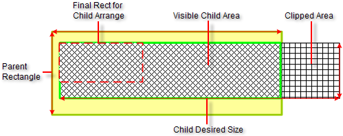

# Clipping

Clipping hides the parts of an element that fall outside a specified clipping rectangle. Unlike Windows Presentation Foundation (WPF), which uses the arrange rectangle as the clipping rectangle, the Telerik Presentation Framework uses the parent rectangle. When the parent's `ClipDrawing` property is `true`, it clips the portion of a child that extends beyond the parent's bounds.

The diagram illustrates three related rectangles:

* The **parent rectangle** defines the clipping boundary.
* The **final rectangle for child arrange** is the space allocated to the child during layout. It is smaller than the child's desired size.
* The **child desired size** extends beyond both the arrange rectangle and the parent's bounds.

The portion of the child inside the parent remains visible, including the portion outside its arrange rectangle. Only the portion outside the parent is clipped. Visibility therefore depends on the parent's bounds, not on whether the child fits in its arrange rectangle.

## See Also
* [Custom Layouts]()

* [Element Offset Calculations]()

* [Layout Activation]()

* [Layout Logic]()

* [Layout Overview]()

* [Layout Structure]()

* [RadControl Testing Considerations]()

* [Sample Arrange Stage Scenarios]()
