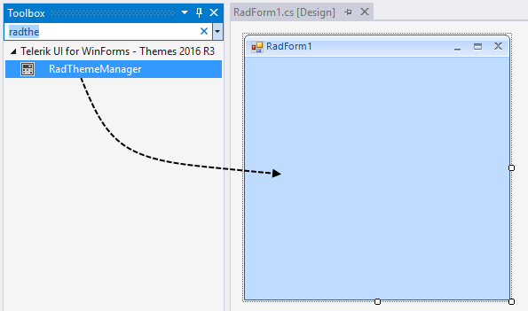
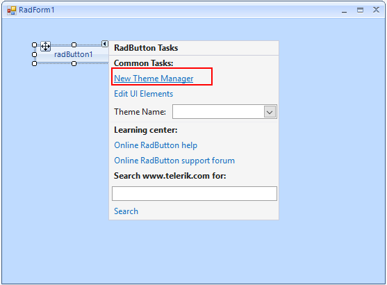

# Adding RadThemeManager to a Form

Progress® Telerik® UI for WinForms `RadThemeManager` is a nonvisual component that manages the connection between themes (stored in XML files) and Telerik controls on your form. To apply a theme to a control, the form containing the control must also contain a `RadThemeManager`.

There are two ways to add a `RadThemeManager` to your form:

* From the Toolbox.

* From the **Smart Tag** menu of any Telerik `RadControl`.

## Adding a Theme Manager from the Toolbox

From the **Telerik UI for WinForms** tab of the **Toolbox**, drag a `RadThemeManager` component and drop it anywhere on your form. This creates a `RadThemeManager` component in the form component tray area.

The following screenshot shows `RadThemeManager` being dragged from the Toolbox onto the form.

## Adding a Theme Manager from the Smart Tag Menu

Select any Telerik `RadControl` on your form. Open the **Smart Tag** menu, and then click **New Theme Manager**.

The following screenshot shows the **New Theme Manager** command in the Smart Tag menu.

## See Also
* [Applying a Theme to a Control]()

* [Add Remove Theme Files]()

* [Load Themes from a Resource]()

* [Load Themes from an External File]()
